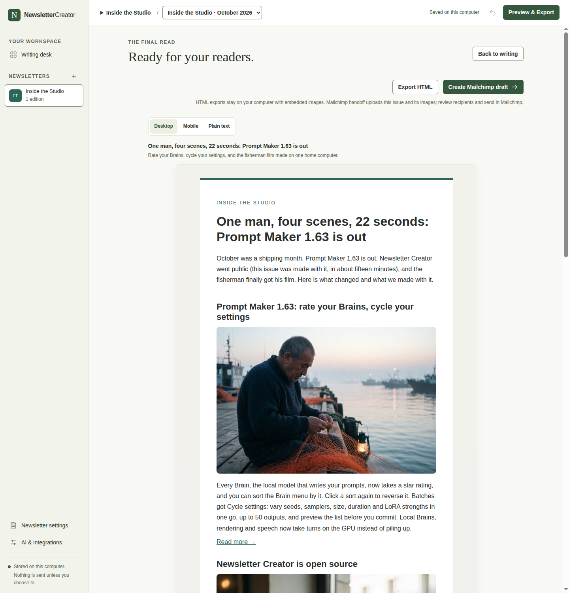
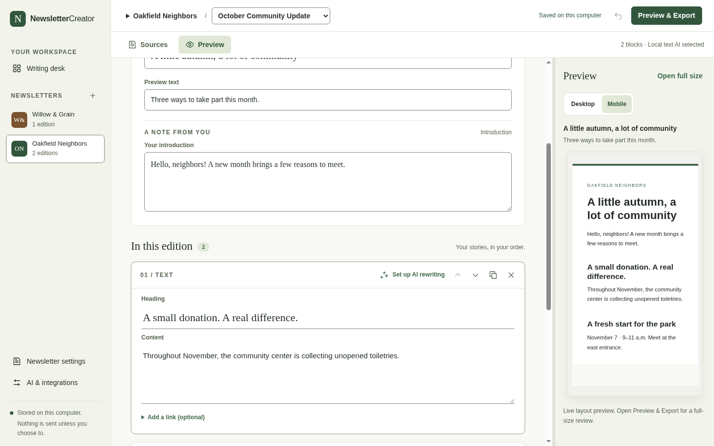
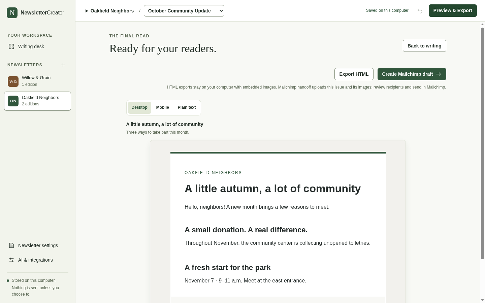
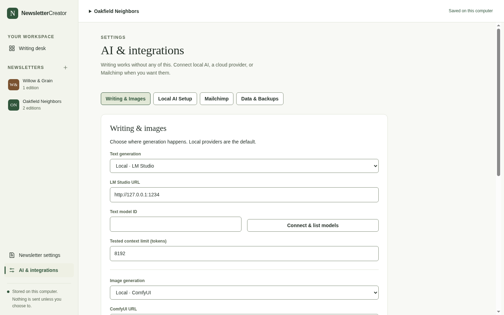
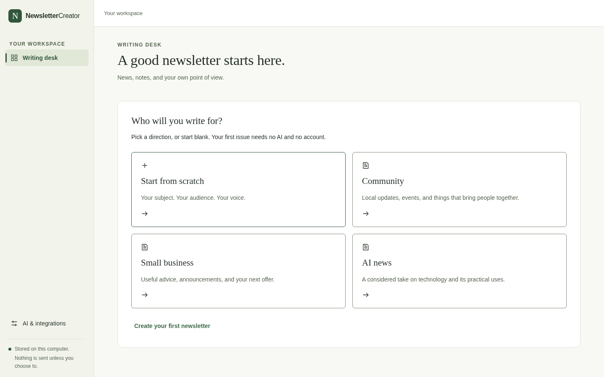
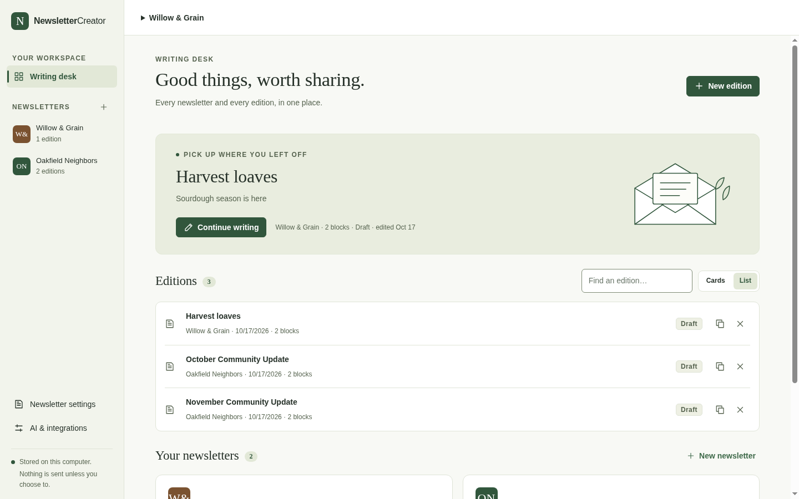
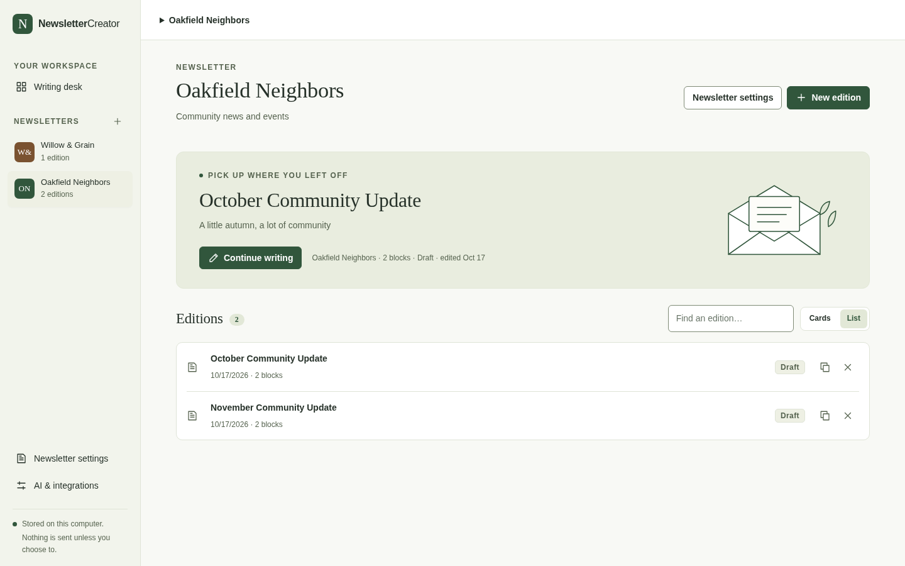
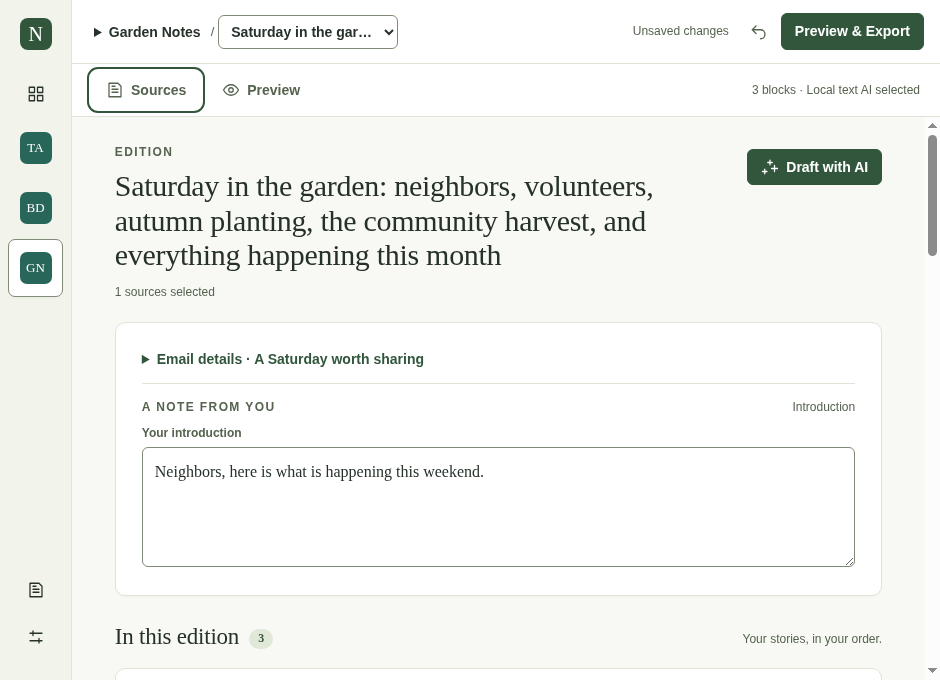

# NewsletterCreator

**Point it at your sources and get a newsletter back.** It gathers the stories, AI running on your own computer sorts them, drafts the edition and makes the pictures, and you get an issue that's ready to send. Keep a few newsletters, write or fix each edition as blocks, preview the email, and export self-contained HTML or hand a draft to Mailchimp.

Free and open source under the [MIT License](LICENSE). **No account. No sign-in. No analytics. Nothing leaves your machine** unless you opt in by connecting a service and using it.



_An issue made with Newsletter Creator, images included, one click from Mailchimp._

## Download

Packages for **Windows (x64)**, **macOS (Apple Silicon and Intel)** and **Linux (x64 AppImage)** are attached to each [GitHub Release](../../releases). They are built by the public workflow in this repository and are **not code-signed** — certificates cost money and this is a free project — so each operating system shows a one-time "unverified software" prompt. The release notes explain the two clicks needed on each platform.

## Features

### Write

- **Writing desk** — every newsletter in the rail with its edition count; a resume card for the edition you edited last; editions as cover cards or a compact list; search.
- **Paper editor** — email subject, preview text and introduction on one card; blocks below for text, events, images and calls to action; move, duplicate and delete; scoped undo (Ctrl/Cmd+Z) that never reverts an unrelated later edit.
- **Autosave you can trust** — "Saved on this computer" appears only after the write succeeds. If a save is ever rejected (another window saved first, disk error), a recovery bar offers _Retry_, _Copy draft as text_ and _Discard edits and reload_. Nothing is overwritten and nothing is lost.
- **Live preview** — a side panel renders the real email as you type; it becomes a drawer on narrow windows.



### Sources (optional)

- Add RSS feeds, websites or single articles per newsletter.
- Collect stories on request; results report which sources succeeded and which failed, and never invent anything.
- Search and filter the inbox, read the source text in place, and **add a story to the issue without any AI**.

### Review & export

- Desktop, mobile and plain-text previews that share one renderer with the export, so what you see is what ships.
- **Export HTML** — one self-contained file with images embedded.
- **Mailchimp draft** — uploads the images, creates or updates a draft campaign, and stops there. No code in this project sends or schedules email.



### AI, only if you want it

- Writing and rewriting with a **local** LM Studio server, images with a **local** ComfyUI server, or a managed local runtime the app installs after you review the publishers' terms.
- OpenRouter and fal.ai are explicit choices. **Local failure never falls back to the cloud.**
- Until a model is chosen, the AI buttons say _Set up AI writing_ and take you to settings instead of opening a dialog that cannot run.
- Generated copy replaces only what you asked for; your original blocks stay, and the change is one undo away.



### Private by construction

- Newsletters, editions and settings live in SQLite under your OS application-data folder; images sit beside it as files.
- API keys use Electron `safeStorage` (OS keychain / DPAPI); where the OS cannot encrypt, keys are kept for the session only.
- Backups contain content, settings and images — never credentials.
- The renderer has no Node, filesystem, credential or network access; a validated IPC boundary delegates to the main process. There are no remote fonts, no analytics, no update checks.

### Designed to be read

- Sage-and-cream interface with serif headings, measured against WCAG 2.2 AA: text clears 4.5:1 on every surface it sits on, field edges clear 3:1, every control is at least 24 px (36 px for buttons). `tests/desktop-contrast.mjs` re-measures the running app and fails on regressions.
- Keyboard: dialogs trap focus and return it on close, panels resize with arrow keys, block tools announce themselves.
- Works from 940 px wide to large displays; panels become drawers below 1100 px.

<p>
  
  
</p>
<p>
  
  
</p>

## Development

Node 22.13+ and npm.

```sh
npm ci
npm run desktop:dev
```

### Verify

```sh
npm run desktop:typecheck
npx eslint apps/desktop/src packages/core/src
npm run test --workspace @newsletter/desktop
npm run desktop:build
xvfb-run -a node tests/desktop-smoke.mjs                                      # Linux; drop xvfb-run on a desktop session
xvfb-run -a -s "-screen 0 1920x1200x24" node tests/desktop-studio.mjs
xvfb-run -a -s "-screen 0 1920x1200x24" node tests/desktop-contrast.mjs
npm run desktop:package
xvfb-run -a node tests/desktop-package-smoke.mjs
```

The smoke test checks create/edit/preview/export, restart recovery and that startup makes zero network requests. The studio suite covers source insertion, scoped undo, generation failure and retry, image persistence, save conflicts and the recovery bar, keyboard controls, modal focus, four window sizes and 125% zoom. The contrast suite re-measures text and control contrast and hit-area minimums on nine seeded views. CI runs all of this on Linux and builds packages on all platforms; a `v*` tag publishes a release.

See [apps/desktop/README.md](apps/desktop/README.md) for the runtime boundaries, the managed local-AI installer, and the hardware and live-service checks that cannot run in CI.

## Repository layout

| Path            | What it is                                                                                                                 |
| --------------- | -------------------------------------------------------------------------------------------------------------------------- |
| `apps/desktop`  | The Electron app: `src/main` (SQLite store, providers, engines, Mailchimp, IPC), `src/renderer` (React UI), `tests` (unit) |
| `packages/core` | Shared schemas, rendering and undo logic used by main and renderer                                                         |
| `tests/`        | Electron end-to-end suites, package smoke, opt-in hardware and live-service scripts                                        |
| `apps/web`      | The earlier Next.js version, kept for regression comparison; not part of the release                                       |
| `docs/`         | Screenshots and the release-notes template                                                                                 |

## Contributing

Issues and pull requests are welcome. Run the verification list above before opening a PR; CI runs the same steps. Keep the three promises the app makes: no account, nothing leaves the machine without an explicit action, and local AI never silently falls back to the cloud.

## License

MIT — see [LICENSE](LICENSE).
